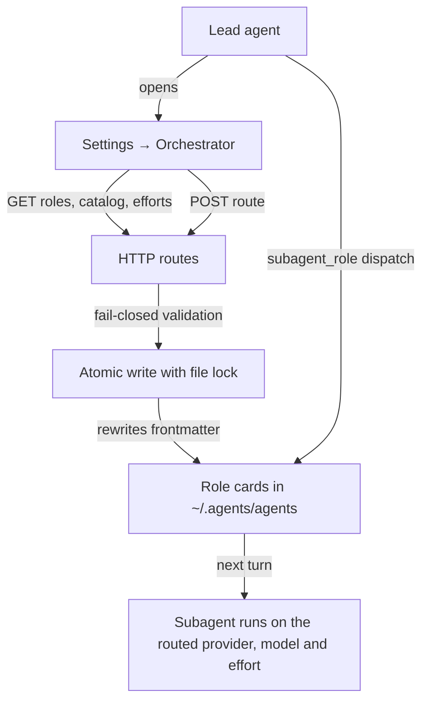

# dsh-orchestrator-kit

Model routing control panel for AI agent teams — assign provider, model and reasoning effort per role of a 20-role dev-flow pipeline, from one settings page.

> **Language:** English · [Português (BR)](README.pt-BR.md) · [简体中文](README.zh-CN.md)

[](https://www.npmjs.com/package/dsh-orchestrator-kit)
[](LICENSE)
[](#install-dsh)
[](https://github.com/klaus-2/dsh-orchestrator-kit/actions/workflows/ci.yml)
[](#install-dsh)



## Why use this

- **Per-role routing** — every role of the Craft dev-flow pipeline (discovery, planning, execution, verification) can run on its own provider, model and reasoning effort.
- **Cost and quality tuning** — spend deep-reasoning capacity only where it pays off (architecture, plan review) and let search-style roles run on cheaper routes.
- **Fail-closed validated configuration** — a save that names an unknown role, model or effort is rejected with 409; an unavailable catalog returns 503. No dead routes are ever written.
- **No provider lock-in** — the panel ships no providers of its own; the selects are fed by the catalog of the running harness.

## How it works



The settings page **Settings → Orchestrator** shows the 20 pipeline roles grouped in the three Craft phases. Each role card stores the chosen route in its frontmatter; the next `subagent_role` dispatch (next turn) picks it up.

## Install (DSH)

Requirements: **Node.js >= 22** and a **DSH instance with Agent Teams** enabled.

1. Clone or download this repository (published on npm as `dsh-orchestrator-kit` v0.1.0 — no global install needed).
2. In DSH, open **Plugins → Add plugin** and point it at the downloaded folder, **or** install it with `install_bundle`.
3. The Orchestrator persona and the 20-role dev-flow pipeline ship inside the preset — nothing else to wire up.

## The Craft pipeline bundle

`craft/` ships the pipeline as plain, portable files:

- `craft/agents/*` → copy to `~/.agents/agents/` (or `$DSH_AGENTS_HOME/agents/` when that variable is set) — the 20 role cards.
- `craft/skills/dev-flow` → copy to `~/.agents/skills/dev-flow` — the dev-flow skill with its playbooks.

Unconfigured roles use `model: inherit` — they follow the chat's routing. Override only the roles you actually want pinned to a fixed model.

## Configure per role

| Control | Behavior |
| --- | --- |
| **Disabled** | Takes the role's route override off. |
| **Provider** | Select from the harness catalog. |
| **Model** | Select from the harness catalog. |
| **Reasoning effort** | Options load lazily per provider + model combination. |
| **Save** | Validates fail-closed, then writes atomically. |
| **Reset — Chat default (inherit)** | Returns the role to `model: inherit`. |

The panel lays the roles out as a responsive card grid. A segmented filter at the top switches between All roles, the three Craft phases and Other (arrow keys move between tabs), and each tab shows its routed / inherit / disabled breakdown beside the tab count. A row of view controls below the legend adds a search box (matches role names or descriptions), a status filter (All statuses, Routed, Inherits chat, Disabled), a sort select (by name, routed first, inherits first — applied within each section) and a density select (cards or compact one-line rows) — all compose with the phase tabs. A collapsible legend explains what each control does, each card carries a status badge (Routed, Inherits chat or Disabled), and the header summarizes the saved counts. Roles that inherit show the chat-default route on the card when the harness catalog exposes a chat default, and comfortable cards reserve their layout space (`content-visibility`) so scrolling stays smooth.

The panel follows the harness language by default: English, Português (BR) and 简体中文 are fully translated, and other host languages fall back to English for panel text. A select in the header switches the panel between Auto (host language), English, Português (BR) and 简体中文 — it changes only the panel, never the harness language. The choice is remembered for the browser session through best-effort `localStorage`; on Desktop the local origin port can change between app restarts, so the override may not survive an app restart. If storage is unavailable, the panel silently follows the host language. Tab choice, legend state and density persist for the browser session through the same best-effort `localStorage`; search and sort are transient.

Saving settings identical to the card's current ones is a no-op: the panel answers "Already up to date" and nothing is written. Cards with invalid frontmatter are named in a warning banner and cannot be edited here until the frontmatter is fixed.

Every edit is protected against losing work. Changing a card marks it unsaved — the card gains an amber border and the role name gains the “ (unsaved)” suffix — and leaving the page with unsaved edits triggers the browser's leave confirmation. Ctrl+S / Cmd+S saves the focused card (a no-op when nothing is focused). Unsaved drafts survive switching tabs and reopening the settings section: they are kept while the card's server state still matches the state the draft was based on, and an external change on disk discards the stale draft. The plain Refresh button resets drafts; the conflict action below is the draft-preserving path. Every save offers Undo: one level per card, for the browser session only, never persisted — it restores the settings from before that save. When a save or undo fails with `409` because the card changed underneath, the message offers “Reload saved state, keep edits”, which re-reads the saved state and reapplies the draft without ever resending the stale `mtimeMs`; a `409` on a save that set a reasoning effort also points to the Reasoning effort select. A polite live region announces the last save or undo outcome, and a saved card keeps a green border until the next change.

The panel talks to six routes: `GET /api/dsh-orchestrator-kit.roles`, `GET /api/dsh-orchestrator-kit.catalog`, `GET /api/dsh-orchestrator-kit.efforts`, `GET /api/dsh-orchestrator-kit.events`, `GET /api/dsh-orchestrator-kit.diagnostics` and `POST /api/dsh-orchestrator-kit.route`. Successful responses carry a `Server-Timing` header (durations only) when a timing metric was measured — roles reads, catalog reads, route validation and writes; an unchanged save that ran no route validation carries none. The legend shows the last load timings.

Every save is protected end to end:

- **Fail-closed validation** — an unknown role, model or effort returns `409`; an unavailable catalog returns `503`. Nothing is written blind.
- **Atomic writes** — a file lock serializes writers, a TOCTOU guard plus post-write revalidation confirm the card, and the expected `mtimeMs` is checked so a concurrent editor is never silently overwritten.
- **Single writer** — the panel is the only writer of these routes, and a saved route takes effect on the next turn.
- **Strict frontmatter write gate** — anchors, aliases and custom YAML tags are refused, and frontmatter is capped at 65536 bytes with a nesting limit. Anchored, tagged or deeply nested cards stay listed but read-only (every write returns `400`) until cleaned; aliased or oversized cards fail even the lenient listing parse and appear only in the invalid-card warning banner, not in the grid.
- **Request limits** — route-save bodies are capped at 65536 bytes (`413` beyond that, before any disk read) and only known fields are accepted (unknown fields return `400`).
- **Busy-lock guidance** — when another writer holds the card lock, the save returns `503` with the lock name and retry guidance; lock files are never removed automatically.
- **Secret redaction** — known secret shapes and user-home paths in error bodies and logs are replaced by `[redacted]` and `[home]` markers, keeping error codes and context intact.
- **Read-only mode** — set `DSH_ORCHESTRATOR_READONLY=1` (or `true`) and the server answers every save with `403` before reading the body or touching disk; the panel mirrors the flag from the roles bootstrap and disables every mutating control, showing a read-only notice. Export stays available — it only reads.

## Batch apply, profiles, change log and diagnostics

- **Batch apply per phase** — on a phase tab (never the "All roles" tab), each section header carries an **Apply to phase** button. It copies the source card's draft route/effort (the first card with a dirty draft) to every other card in that section, posting one save per card with its own expected `mtimeMs`. Results are per-card: a `409` conflict keeps the loop going and reports on that card, a non-409 failure (for example the `503` busy lock) stops the run and reports what was applied, and a Cancel button stops after the in-flight card. Batch apply is never atomic — it is a sequence of ordinary validated saves.
- **Routing profiles** — **Export profile** writes the saved routes of all roles to a versioned JSON (`version: 1`, `generator`, `roles` keyed by role id; no `mtimeMs` anywhere). **Import profile** validates every entry first — unsupported version, half-written routes or malformed ids reject the whole file and write nothing; ids unknown on this machine are skipped with a count. After validation passes, the panel refreshes the card list (fresh mtimes), then applies each entry as a normal save; failed entries are reported and nothing is silently overwritten.
- **Recent changes** — every successful save appends one record to an append-only JSONL file beside the cards (`.orchestrator-audit.jsonl`): time, role id, previous/next route, origin. It stores no secrets and no absolute paths, and it is best-effort — an audit-write failure never fails or rolls back the save. The panel's **Recent changes** section (inside the legend) shows the last 50 records and is fetched on demand, never cached.
- **Installed-card diagnostics** — a read-only section (inside the legend) reports roles missing from the installed set versus the `craft/` sources, cards with invalid frontmatter, routes naming a model absent from the live catalog, and cards whose body differs from the craft source (frontmatter legitimately diverges, bodies are compared). Computed on demand, never cached; it degrades gracefully when `craft/` is absent.

## Install the craft bundle with the script

Instead of copying `craft/` by hand:

```
node scripts/install-craft.js [--dry-run]
```

The script copies the 20 role cards into the agents root (`$DSH_AGENTS_HOME/agents/` when that variable is set, otherwise `~/.agents/agents/`) and the dev-flow skill tree into `<agents home>/skills/dev-flow/`. It **skips existing files always** — no overwrite mode, no backups — so a user-edited card is never clobbered; delete the file to reinstall it. A held writer lock produces the documented retry/operator guidance and the script exits 1. `--dry-run` reports what would be copied without writing anything.

## The 20 roles

**Discovery & Advisory**

| Role | Duty |
| --- | --- |
| `repo-scout` | Local codebase search: locate code, patterns and facts. |
| `docs-scout` | External docs and OSS examples research. |
| `media-analyst` | Read PDFs, images and screenshots. |
| `arch-advisor` | Architecture decisions and deep review. |

**Planning & Execution**

| Role | Duty |
| --- | --- |
| `scope-analyst` | Pre-plan gap and ambiguity analysis. |
| `planner` | Write `.devflow/plans/*.md` plans. |
| `plan-auditor` | Audit plans for clarity and verifiability (`OKAY`/`REJECT` gate). |
| `run-conductor` | One-hop plan orchestration and contract freeze. |
| `implementer` | Scoped code and config writes. |
| `debugger` | Root-cause reproduction and surgical fixes. |

**Verification, QA & Docs**

| Role | Duty |
| --- | --- |
| `diff-reviewer` | Final merge-readiness review. |
| `test-auditor` | Test sufficiency and gap rating. |
| `test-writer` | Failure-reproducing tests and anti-flake checks. |
| `browser-qa` | Live browser and UI QA. |
| `error-auditor` | Silent-failure and error-path audit. |
| `security-auditor` | Trust-model security review. |
| `perf-auditor` | Latency, N+1 and memory/process leak review. |
| `debt-auditor` | Maintainability and dead-path audit. |
| `docs-sync` | Immediate docs reconciliation. |
| `tech-writer` | Durable README, architecture and API docs. |

## FAQ

**Why do I get a 409 when saving a model?**
The panel validates every save against the catalog of the running harness. A 409 means the role, model or effort you picked does not exist there — pick a valid entry instead of bypassing the check.

**Why do I get a 503 "busy" error when saving?**
Another writer holds the card's lock. Retry in a moment. If the lock is orphaned because its owner crashed, an operator must remove the `<card>.md.lock` file beside the card — the plugin never removes locks automatically.

**What does "Already up to date" mean?**
The save was a no-op: the settings match the card exactly, so nothing was written and no lock was acquired. Validation still runs first — a card that changed on disk still returns `409`. The catalog is checked only when the save sets an explicit route: an identical route save still returns `503` when the catalog is unavailable, while identical disabled-only or effort-only saves (and resets to inherit) never consult the catalog.

**Where do the role cards live?**
Under `$DSH_AGENTS_HOME/agents/` when that variable is set, otherwise `~/.agents/agents/`. The panel is the only writer of route frontmatter.

**How do I reset a role?**
Use the role's reset control ("Chat default (inherit)"); it sets `model: inherit` and the role follows the chat's routing again.

**How does Undo work?**
Every successful save offers an Undo button on that card. Undo restores the settings from immediately before that save — one level per card, for the browser session only, never persisted, and it never chains (undoing creates no new snapshot, so there is nothing to redo). The undo request carries the pre-save settings and the recorded post-save `mtimeMs`, so a card that changed on disk in between answers `409` with the conflict message.

**What do the numbers beside the tabs mean?**
Each tab shows a `routed / inherit / disabled` breakdown of its roles in saved state, regardless of any active search or filter. Its three numbers are mutually exclusive and add up to the tab count; the header summary counts routed and disabled roles separately, so those figures can overlap.

**Does it work without Agent Teams?**
No. Routes are applied when DSH dispatches members through `subagent_role`, which requires Agent Teams.

**How do I apply a route to a whole phase?**
Switch to that phase's tab, set the route/effort you want on one card (it stays unsaved), and press the **Apply to phase** button in the section header. Every other card in the section receives that route as its own validated save; the summary counts applied roles, conflicts and failures, and the Cancel button stops after the card in flight.

**How do I move my routing to another machine?**
Use **Export profile** to download a versioned JSON of all saved routes, and **Import profile** on the other machine. Import validates the whole file before writing anything, skips role ids that do not exist locally, and applies each entry with a freshly read `mtimeMs` — never trusting mtimes carried by the file (there are none).

**Where is the change log stored?**
In an append-only JSONL file beside the role cards: `$DSH_AGENTS_HOME/agents/.orchestrator-audit.jsonl` when that variable is set, otherwise `~/.agents/agents/.orchestrator-audit.jsonl`. One line per successful save; the panel's Recent changes section shows the last 50. The file grows by design — trim it manually if you do not want the history.

**Do I need provider API keys?**
No. The kit has no embedded providers — the selects list what the harness catalog already offers, with the credentials the harness itself holds.

**Which languages does the panel support?**
English, Português (BR) and 简体中文 (en/pt-BR/zh). The panel follows the harness language by default, and the header select switches the panel manually without touching the harness language. While the plugin is active, Português (BR) also becomes a selectable harness language (removed when the plugin is deactivated), and generic Portuguese (`pt`) resolves to the pt-BR dictionary. Role names, card content, provider/model/effort names and counts are data and stay as-is.

**How do I add or fix a translation?**
Edit the `panel` object in `locale/<lang>.json`, then mirror the change verbatim into `PANEL_DICTS` in `client.js`. The test suite enforces parity — identical key sets across the three locale files and registered dictionaries identical to the JSON `panel` sections — so any drift fails the suite.

## Contributing

Small PRs, Conventional Commits, and `node scripts/test.mjs` green three times before you push — see [CONTRIBUTING.md](CONTRIBUTING.md).

## Security

No remote-execution surface: the kit only serves local HTTP routes and writes role-card frontmatter. The audit log records role ids and route values only — never secrets, absolute paths or card contents — and the read-only mode plus the install script are documented in [SECURITY.md](SECURITY.md). Report issues privately per [SECURITY.md](SECURITY.md).

## License

[MIT](LICENSE). Changes are tracked in [CHANGELOG.md](CHANGELOG.md).
