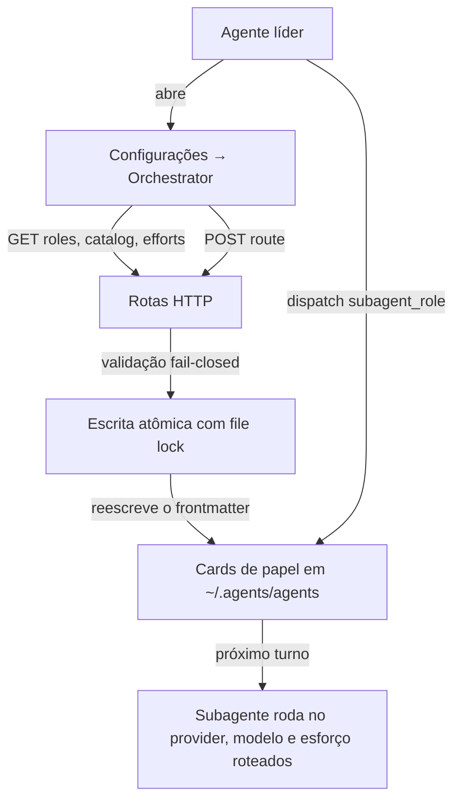

# dsh-orchestrator-kit

Painel de controle de roteamento de modelos para times de agentes de IA — atribua provider, modelo e esforço de raciocínio por papel de um pipeline dev-flow de 20 papéis, a partir de uma página de configurações.

> **Idioma:** [English](README.md) · Português (BR) · [简体中文](README.zh-CN.md)

## Por que usar

- **Roteamento por papel** — cada papel do pipeline dev-flow Craft (descoberta, planejamento, execução, verificação) pode rodar em seu próprio provider, modelo e esforço de raciocínio.
- **Ajuste de custo e qualidade** — gaste capacidade de raciocínio profundo só onde compensa (arquitetura, revisão de plano) e deixe papéis de busca rodarem em rotas mais baratas.
- **Configuração validada fail-closed** — um salvamento que citar papel, modelo ou esforço desconhecido é rejeitado com 409; catálogo indisponível devolve 503. Nenhuma rota morta é escrita.
- **Sem lock-in de provider** — o painel não embute providers; os selects são alimentados pelo catálogo do próprio harness em execução.

## Como funciona

A página **Configurações → Orchestrator** mostra os 20 papéis do pipeline agrupados nas três fases Craft. Cada card de papel guarda a rota escolhida no seu frontmatter; o próximo dispatch de `subagent_role` (próximo turno) a assume.

## Instalação (DSH)

Requisitos: **Node.js >= 22** e uma **instância DSH com Agent Teams** ativado.

1. Clone ou baixe este repositório (publicado no npm como `dsh-orchestrator-kit` v0.1.0 — sem instalação global).
2. No DSH, abra **Plugins → Add plugin** e aponte para a pasta baixada, **ou** instale com `install_bundle`.
3. A persona Orchestrator e o pipeline dev-flow de 20 papéis já vêm no preset — nada mais para configurar.

## Bundle do pipeline Craft

`craft/` entrega o pipeline como arquivos simples e portáteis:

- `craft/agents/*` → copie para `~/.agents/agents/` (ou `$DSH_AGENTS_HOME/agents/` quando a variável estiver definida) — os 20 cards de papel.
- `craft/skills/dev-flow` → copie para `~/.agents/skills/dev-flow` — a skill dev-flow com seus playbooks.

Papéis não configurados usam `model: inherit` — seguem o roteamento do chat. Sobrescreva apenas os papéis que você realmente quer fixar em um modelo.

## Configurar por papel

| Controle | Comportamento |
| --- | --- |
| **Disabled** | Remove a sobrescrita de rota do papel. |
| **Provider** | Seleção do catálogo do harness. |
| **Model** | Seleção do catálogo do harness. |
| **Reasoning effort** | Opções carregam de forma lazy por combinação provider + modelo. |
| **Save** | Valida fail-closed e escreve atomicamente. |
| **Reset — Padrão do chat (herdar)** | Devolve o papel para `model: inherit`. |

O painel organiza os papéis em uma grade responsiva de cartões. Um filtro segmentado no topo alterna entre All roles, as três fases Craft e Other (as setas do teclado navegam entre as abas), e cada aba mostra sua distribuição roteado / herdado / desativado ao lado da contagem da aba. Uma linha de controles de visualização abaixo da legenda adiciona uma caixa de busca (corresponde a nomes ou descrições de papéis), um filtro de status (Todos os status, Roteado, Herdado do chat, Desativado), um select de ordenação (por nome, roteados primeiro, herdados primeiro — aplicada dentro de cada seção) e um select de densidade (cartões ou lista compacta de linhas) — tudo compõe com as abas de fase. Uma legenda recolhível explica o que cada controle faz, cada cartão traz um selo de status (Routed, Inherits chat ou Disabled) e o cabeçalho resume as contagens salvas. Papéis que herdam mostram a rota padrão do chat no cartão quando o catálogo do harness expõe um padrão do chat, e os cartões no modo padrão reservam seu espaço de layout (`content-visibility`) para a rolagem continuar suave.

O painel segue o idioma do harness por padrão: English, Português (BR) e 简体中文 têm tradução completa, e outros idiomas do host usam o inglês como fallback para os textos do painel. Um select no cabeçalho alterna o painel entre Automático (idioma do host), English, Português (BR) e 简体中文 — muda apenas o painel, nunca o idioma do harness. A escolha é lembrada para a sessão do navegador via `localStorage` em modo best-effort; no Desktop a porta da origem local pode mudar entre reinícios do aplicativo, então a sobrescrita pode não sobreviver a um reinício do app. Se o armazenamento estiver indisponível, o painel segue silenciosamente o idioma do host. Aba escolhida, estado da legenda e densidade persistem para a sessão do navegador pelo mesmo `localStorage` best-effort; busca e ordenação são transientes.

Salvar configurações idênticas às que já estão no card é um no-op: o painel responde "Already up to date" e nada é escrito. Cards com frontmatter inválido são listados em um banner de aviso e não podem ser editados aqui até o frontmatter ser corrigido.

Toda edição é protegida contra perda de trabalho. Alterar um card o marca como não salvo — o card ganha uma borda âmbar e o nome do papel ganha o sufixo “ (não salvo)” — e sair da página com edições não salvas dispara a confirmação de saída do navegador. Ctrl+S / Cmd+S salva o card em foco (no-op quando nada está em foco). Rascunhos não salvos sobrevivem à troca de abas e à reabertura da seção de configurações: eles são mantidos enquanto o estado do card no servidor ainda corresponde ao estado em que o rascunho se baseou, e uma mudança externa no disco descarta o rascunho obsoleto. O botão Refresh comum reseta os rascunhos; a ação de conflito abaixo é o caminho que preserva rascunhos. Cada salvamento oferece Desfazer: um nível por card, apenas para a sessão do navegador, nunca persistido — ele restaura as configurações anteriores àquele salvamento. Quando um salvamento ou desfazer falha com `409` porque o card mudou por baixo, a mensagem oferece “Recarregar estado salvo, manter edições”, que relê o estado salvo e reaplica o rascunho sem jamais reenviar o `mtimeMs` obsoleto; um `409` em um salvamento que definiu um esforço de raciocínio também aponta para o select de Esforço de raciocínio. Uma região aria-live polite anuncia o resultado do último salvamento ou desfazer, e um card salvo mantém uma borda verde até a próxima alteração.

O painel fala com quatro rotas: `GET /api/dsh-orchestrator-kit.roles`, `GET /api/dsh-orchestrator-kit.catalog`, `GET /api/dsh-orchestrator-kit.efforts` e `POST /api/dsh-orchestrator-kit.route`. Respostas bem-sucedidas trazem um cabeçalho `Server-Timing` (apenas durações) quando uma métrica de tempo foi medida — leituras de roles, leituras de catalog, validação de rota e escritas; um salvamento sem alteração que não executou validação de rota não traz nenhum. A legenda mostra os tempos do último carregamento.

Cada salvamento é protegido de ponta a ponta:

- **Validação fail-closed** — papel, modelo ou esforço desconhecido retorna `409`; catálogo indisponível retorna `503`. Nada é escrito às cegas.
- **Escritas atômicas** — um file lock serializa os escritores, uma guarda TOCTOU com revalidação pós-escrita confirma o card, e o `mtimeMs` esperado é conferido para que um editor concorrente nunca seja sobrescrito em silêncio.
- **Escritor único** — o painel é o único escritor dessas rotas, e uma rota salva vale a partir do próximo turno.
- **Gate estrito de escrita do frontmatter** — anchors, aliases e tags YAML customizadas são recusados, e o frontmatter é limitado a 65536 bytes com um limite de aninhamento. Cards com anchors, tags ou aninhamento profundo continuam listados, mas somente leitura (toda escrita retorna `400`) até serem limpos; cards com aliases ou acima do limite de bytes falham até no parse tolerante da listagem e aparecem apenas no banner de aviso de cards inválidos, não na grade.
- **Limites de requisição** — corpos de salvamento de rota são limitados a 65536 bytes (`413` acima disso, antes de qualquer leitura de disco) e apenas campos conhecidos são aceitos (campos desconhecidos retornam `400`).
- **Orientação no lock ocupado** — quando outro escritor segura o lock do card, o salvamento retorna `503` com o nome do lock e orientação de nova tentativa; arquivos de lock nunca são removidos automaticamente.
- **Ocultação de segredos** — formas conhecidas de segredos e caminhos do diretório pessoal do usuário em corpos de erro e logs são substituídos pelos marcadores `[redacted]` e `[home]`, mantendo códigos de erro e contexto intactos.

## Os 20 papéis

**Discovery & Advisory**

| Papel | Função |
| --- | --- |
| `repo-scout` | Busca local no codebase: localizar código, padrões e fatos. |
| `docs-scout` | Pesquisa de documentação externa e exemplos OSS. |
| `media-analyst` | Ler PDFs, imagens e screenshots. |
| `arch-advisor` | Decisões de arquitetura e revisão profunda. |

**Planning & Execution**

| Papel | Função |
| --- | --- |
| `scope-analyst` | Análise de lacunas e ambiguidades antes do plano. |
| `planner` | Escrever planos em `.devflow/plans/*.md`. |
| `plan-auditor` | Auditar planos quanto a clareza e verificabilidade (gate `OKAY`/`REJECT`). |
| `run-conductor` | Orquestração de plano em um salto e congelamento de contrato. |
| `implementer` | Escritas de código e configuração com escopo. |
| `debugger` | Reprodução de causa raiz e correções cirúrgicas. |

**Verification, QA & Docs**

| Papel | Função |
| --- | --- |
| `diff-reviewer` | Revisão final de prontidão para merge. |
| `test-auditor` | Suficiência de testes e classificação de lacunas. |
| `test-writer` | Testes que reproduzem falhas e checagens anti-flake. |
| `browser-qa` | QA ao vivo de navegador e UI. |
| `error-auditor` | Auditoria de falhas silenciosas e caminhos de erro. |
| `security-auditor` | Revisão de segurança do modelo de confiança. |
| `perf-auditor` | Revisão de latência, N+1 e vazamentos de memória/processo. |
| `debt-auditor` | Auditoria de manutenibilidade e caminhos mortos. |
| `docs-sync` | Reconciliação imediata de documentação. |
| `tech-writer` | Documentação durável: README, arquitetura e APIs. |

## Perguntas frequentes

**Por que recebo 409 ao salvar um modelo?**
O painel valida cada salvamento contra o catálogo do harness em execução. Um 409 significa que o papel, modelo ou esforço escolhido não existe lá — escolha uma entrada válida em vez de contornar a checagem.

**Por que recebo um erro 503 "busy" ao salvar?**
Outro escritor está com o lock do card. Tente novamente em instantes. Se o lock ficou órfão porque o processo dono falhou, um operador deve remover o arquivo `<card>.md.lock` ao lado do card — o plugin nunca remove locks automaticamente.

**O que significa "Already up to date"?**
O salvamento foi um no-op: as configurações são idênticas às do card, então nada foi escrito e nenhum lock foi adquirido. A validação ainda roda antes — um card alterado no disco continua retornando `409`. O catálogo só é consultado quando o salvamento define uma rota explícita: um salvamento idêntico de rota continua retornando `503` quando o catálogo está indisponível, enquanto salvamentos idênticos apenas de disabled ou de esforço de raciocínio (e resets para inherit) nunca consultam o catálogo.

**Onde ficam os cards de papel?**
Em `$DSH_AGENTS_HOME/agents/` quando a variável estiver definida, caso contrário em `~/.agents/agents/`. O painel é o único escritor do frontmatter de rotas.

**Como resetar um papel?**
Use o controle de reset do papel ("Padrão do chat (herdar)"); ele define `model: inherit` e o papel volta a seguir o roteamento do chat.

**Como funciona o Desfazer?**
Cada salvamento bem-sucedido oferece um botão Desfazer naquele card. O Desfazer restaura as configurações de imediatamente antes daquele salvamento — um nível por card, apenas para a sessão do navegador, nunca persistido, e não encadeia (desfazer não cria novo snapshot, então não há nada para refazer). A requisição de desfazer carrega as configurações pré-salvamento e o `mtimeMs` pós-salvamento registrado, então um card que mudou no disco nesse intervalo responde `409` com a mensagem de conflito.

**O que significam os números ao lado das abas?**
Cada aba mostra uma distribuição `roteado / herdado / desativado` dos seus papéis no estado salvo, independentemente de busca ou filtro ativos. Esses três números são mutuamente exclusivos e somam a contagem da aba; o resumo do cabeçalho conta papéis roteados e desativados separadamente, então esses valores podem se sobrepor.

**Funciona sem Agent Teams?**
Não. As rotas são aplicadas quando o DSH despacha membros por `subagent_role`, que exige Agent Teams.

**Preciso de chaves de provider?**
Não. O kit não embute providers — os selects listam o que o catálogo do harness já oferece, com as credenciais que o próprio harness guarda.

**Quais idiomas o painel suporta?**
English, Português (BR) e 简体中文 (en/pt-BR/zh). O painel segue o idioma do harness por padrão, e o select no cabeçalho troca o idioma do painel manualmente sem tocar no idioma do harness. Enquanto o plugin estiver ativo, Português (BR) também fica disponível como idioma do harness (removido ao desativar o plugin), e o português genérico (`pt`) resolve para o dicionário pt-BR. Nomes de papéis, conteúdo dos cards, nomes de provider/modelo/esforço e contagens são dados e permanecem como estão.

**Como adicionar ou corrigir uma tradução?**
Edite o objeto `panel` em `locale/<lang>.json` e replique a alteração de forma idêntica no `PANEL_DICTS` em `client.js`. A suíte de testes exige paridade — conjuntos de chaves idênticos entre os três arquivos de locale e dicionários registrados idênticos às seções `panel` do JSON —, então qualquer divergência quebra a suíte.

## Contributing

PRs pequenos, Conventional Commits e `node scripts/test.mjs` verde três vezes antes de enviar — veja [CONTRIBUTING.md](CONTRIBUTING.md).

## Segurança

Sem superfície de execução remota: o kit só serve rotas HTTP locais e escreve frontmatter de cards de papel. Reporte vulnerabilidades em privado conforme [SECURITY.md](SECURITY.md).

## Licença

[MIT](LICENSE). Mudanças são rastreadas em [CHANGELOG.md](CHANGELOG.md).
