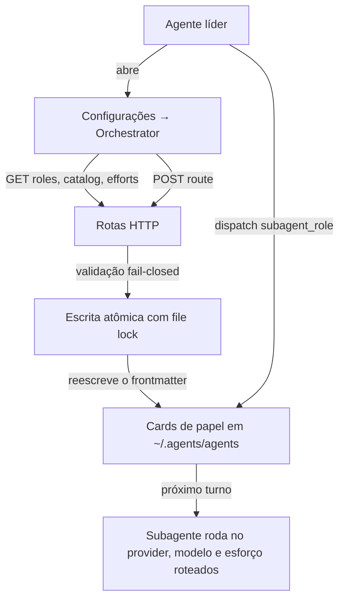

# dsh-orchestrator-kit

Painel de controle de roteamento de modelos para times de agentes de IA — atribua provider, modelo e esforço de raciocínio por papel de um pipeline dev-flow de 20 papéis, a partir de uma página de configurações.

> **Idioma:** [English](README.md) · Português (BR) · [简体中文](README.zh-CN.md)

## Por que usar

- **Roteamento por papel** — cada papel do pipeline dev-flow Craft (descoberta, planejamento, execução, verificação) pode rodar em seu próprio provider, modelo e esforço de raciocínio.
- **Ajuste de custo e qualidade** — gaste capacidade de raciocínio profundo só onde compensa (arquitetura, revisão de plano) e deixe papéis de busca rodarem em rotas mais baratas.
- **Configuração validada fail-closed** — um salvamento que citar papel, modelo ou esforço desconhecido é rejeitado com 409; catálogo indisponível devolve 503. Nenhuma rota morta é escrita.
- **Sem lock-in de provider** — o painel não embute providers; os selects são alimentados pelo catálogo do próprio harness em execução.

## Como funciona

A página **Configurações → Orchestrator** mostra os 20 papéis do pipeline agrupados nas três fases Craft. Cada card de papel guarda a rota escolhida no seu frontmatter; o próximo dispatch de `subagent_role` (próximo turno) a assume.

## Instalação (DSH)

Requisitos: **Node.js >= 22** e uma **instância DSH com Agent Teams** ativado.

1. Clone ou baixe este repositório (publicado no npm como `dsh-orchestrator-kit` v0.1.0 — sem instalação global).
2. No DSH, abra **Plugins → Add plugin** e aponte para a pasta baixada, **ou** instale com `install_bundle`.
3. A persona Orchestrator e o pipeline dev-flow de 20 papéis já vêm no preset — nada mais para configurar.

## Bundle do pipeline Craft

`craft/` entrega o pipeline como arquivos simples e portáteis:

- `craft/agents/*` → copie para `~/.agents/agents/` (ou `$DSH_AGENTS_HOME/agents/` quando a variável estiver definida) — os 20 cards de papel.
- `craft/skills/dev-flow` → copie para `~/.agents/skills/dev-flow` — a skill dev-flow com seus playbooks.

Papéis não configurados usam `model: inherit` — seguem o roteamento do chat. Sobrescreva apenas os papéis que você realmente quer fixar em um modelo.

## Configurar por papel

| Controle | Comportamento |
| --- | --- |
| **Disabled** | Remove a sobrescrita de rota do papel. |
| **Provider** | Seleção do catálogo do harness. |
| **Model** | Seleção do catálogo do harness. |
| **Reasoning effort** | Opções carregam de forma lazy por combinação provider + modelo. |
| **Save** | Valida fail-closed e escreve atomicamente. |
| **Reset — Padrão do chat (herdar)** | Devolve o papel para `model: inherit`. |

O painel organiza os papéis em uma grade responsiva de cartões. Um filtro segmentado no topo alterna entre All roles, as três fases Craft e Other (as setas do teclado navegam entre as abas). Uma legenda recolhível explica o que cada controle faz, cada cartão traz um selo de status (Routed, Inherits chat ou Disabled) e o cabeçalho resume as contagens salvas. Os rótulos dos controles são exibidos em inglês.

O painel fala com quatro rotas: `GET /api/dsh-orchestrator-kit.roles`, `GET /api/dsh-orchestrator-kit.catalog`, `GET /api/dsh-orchestrator-kit.efforts` e `POST /api/dsh-orchestrator-kit.route`.

Cada salvamento é protegido de ponta a ponta:

- **Validação fail-closed** — papel, modelo ou esforço desconhecido retorna `409`; catálogo indisponível retorna `503`. Nada é escrito às cegas.
- **Escritas atômicas** — um file lock serializa os escritores, uma guarda TOCTOU com revalidação pós-escrita confirma o card, e o `mtimeMs` esperado é conferido para que um editor concorrente nunca seja sobrescrito em silêncio.
- **Escritor único** — o painel é o único escritor dessas rotas, e uma rota salva vale a partir do próximo turno.

## Os 20 papéis

**Discovery & Advisory**

| Papel | Função |
| --- | --- |
| `repo-scout` | Busca local no codebase: localizar código, padrões e fatos. |
| `docs-scout` | Pesquisa de documentação externa e exemplos OSS. |
| `media-analyst` | Ler PDFs, imagens e screenshots. |
| `arch-advisor` | Decisões de arquitetura e revisão profunda. |

**Planning & Execution**

| Papel | Função |
| --- | --- |
| `scope-analyst` | Análise de lacunas e ambiguidades antes do plano. |
| `planner` | Escrever planos em `.devflow/plans/*.md`. |
| `plan-auditor` | Auditar planos quanto a clareza e verificabilidade (gate `OKAY`/`REJECT`). |
| `run-conductor` | Orquestração de plano em um salto e congelamento de contrato. |
| `implementer` | Escritas de código e configuração com escopo. |
| `debugger` | Reprodução de causa raiz e correções cirúrgicas. |

**Verification, QA & Docs**

| Papel | Função |
| --- | --- |
| `diff-reviewer` | Revisão final de prontidão para merge. |
| `test-auditor` | Suficiência de testes e classificação de lacunas. |
| `test-writer` | Testes que reproduzem falhas e checagens anti-flake. |
| `browser-qa` | QA ao vivo de navegador e UI. |
| `error-auditor` | Auditoria de falhas silenciosas e caminhos de erro. |
| `security-auditor` | Revisão de segurança do modelo de confiança. |
| `perf-auditor` | Revisão de latência, N+1 e vazamentos de memória/processo. |
| `debt-auditor` | Auditoria de manutenibilidade e caminhos mortos. |
| `docs-sync` | Reconciliação imediata de documentação. |
| `tech-writer` | Documentação durável: README, arquitetura e APIs. |

## Perguntas frequentes

**Por que recebo 409 ao salvar um modelo?**
O painel valida cada salvamento contra o catálogo do harness em execução. Um 409 significa que o papel, modelo ou esforço escolhido não existe lá — escolha uma entrada válida em vez de contornar a checagem.

**Onde ficam os cards de papel?**
Em `$DSH_AGENTS_HOME/agents/` quando a variável estiver definida, caso contrário em `~/.agents/agents/`. O painel é o único escritor do frontmatter de rotas.

**Como resetar um papel?**
Use o controle de reset do papel ("Padrão do chat (herdar)"); ele define `model: inherit` e o papel volta a seguir o roteamento do chat.

**Funciona sem Agent Teams?**
Não. As rotas são aplicadas quando o DSH despacha membros por `subagent_role`, que exige Agent Teams.

**Preciso de chaves de provider?**
Não. O kit não embute providers — os selects listam o que o catálogo do harness já oferece, com as credenciais que o próprio harness guarda.

## Contributing

PRs pequenos, Conventional Commits e `node scripts/test.mjs` verde três vezes antes de enviar — veja [CONTRIBUTING.md](CONTRIBUTING.md).

## Segurança

Sem superfície de execução remota: o kit só serve rotas HTTP locais e escreve frontmatter de cards de papel. Reporte vulnerabilidades em privado conforme [SECURITY.md](SECURITY.md).

## Licença

[MIT](LICENSE). Mudanças são rastreadas em [CHANGELOG.md](CHANGELOG.md).
