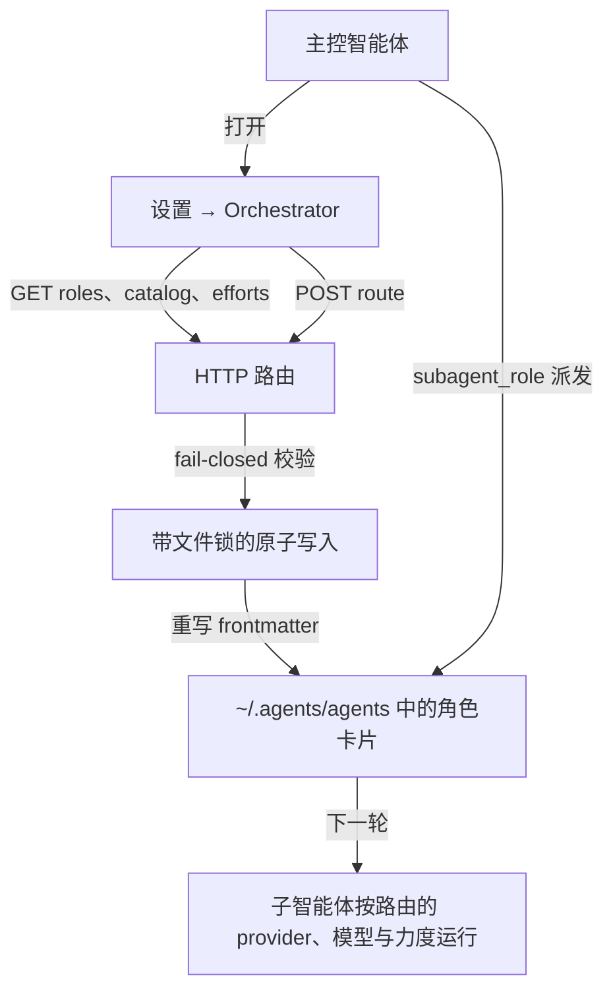

# dsh-orchestrator-kit

面向 AI 智能体团队的模型路由控制面板 — 在同一个设置页面中，为 20 角色 dev-flow 流水线中的每个角色分配 provider、模型与推理力度。

> **语言：** [English](README.md) · [Português (BR)](README.pt-BR.md) · 简体中文

## 为什么使用

- **按角色路由** — Craft dev-flow 流水线（发现、规划、执行、验证）中的每个角色都可以使用自己的 provider、模型和推理力度。
- **成本与质量调优** — 只在真正划算的地方（架构、计划评审）投入深度推理能力，让检索类角色跑在更便宜的路由上。
- **fail-closed 校验的配置** — 保存时引用了未知角色、模型或力度会被以 409 拒绝；目录不可用返回 503。绝不写入死路由。
- **无 provider 锁定** — 面板本身不内置任何 provider；下拉列表由运行中的 harness 目录提供。

## 工作原理

设置页 **设置 → Orchestrator** 按三个 Craft 阶段分组展示 20 个流水线角色。每个角色卡片将所选路由写入其 frontmatter；下一次 `subagent_role` 派发（下一轮）即会生效。

## 安装（DSH）

要求：**Node.js >= 22**，以及启用 Agent Teams 的 **DSH 实例**。

1. 克隆或下载本仓库（已以 `dsh-orchestrator-kit` v0.1.0 发布到 npm — 无需全局安装）。
2. 在 DSH 中打开 **插件 → 添加插件**，指向下载的文件夹，**或**使用 `install_bundle` 安装。
3. Orchestrator 人设与 20 角色 dev-flow 流水线已随预设提供 — 无需额外配置。

## Craft 流水线捆绑包

`craft/` 以简单、可移植的文件形式提供流水线：

- `craft/agents/*` → 复制到 `~/.agents/agents/`（设置了 `$DSH_AGENTS_HOME` 时为 `$DSH_AGENTS_HOME/agents/`）— 20 张角色卡片。
- `craft/skills/dev-flow` → 复制到 `~/.agents/skills/dev-flow` — dev-flow 技能及其 playbook。

未配置的角色使用 `model: inherit` — 跟随会话的路由。只覆盖你真正想固定到某个模型的角色。

## 按角色配置

| 控件 | 行为 |
| --- | --- |
| **Disabled** | 取消该角色的路由覆盖。 |
| **Provider** | 从 harness 目录中选择。 |
| **Model** | 从 harness 目录中选择。 |
| **Reasoning effort** | 选项按 provider + 模型的组合懒加载。 |
| **Save** | 先做 fail-closed 校验，再原子写入。 |
| **重置 — 会话默认（继承）** | 将角色恢复为 `model: inherit`。 |

面板以响应式卡片网格布局角色。顶部分段过滤器可在 All roles、三个 Craft 阶段与 Other 之间切换（方向键在标签间移动）。可折叠图例说明每个控件的作用，每张卡片带状态徽标（Routed、Inherits chat 或 Disabled），页眉汇总已保存的计数。控件标签以英文显示。

保存与卡片当前完全相同的设置是一次空操作：面板会提示 “Already up to date”，不会写入任何内容。frontmatter 无效的卡片会在警告横幅中列出，在 frontmatter 修复之前无法在此编辑。

面板使用四条路由：`GET /api/dsh-orchestrator-kit.roles`、`GET /api/dsh-orchestrator-kit.catalog`、`GET /api/dsh-orchestrator-kit.efforts` 和 `POST /api/dsh-orchestrator-kit.route`。成功的响应在实际测量到耗时指标时才带有 `Server-Timing` 头（仅含耗时）——roles 读取、catalog 读取、路由校验与写入；未执行路由校验的无变更保存不带该头。图例显示最近一次加载的耗时。

每次保存都有端到端保护：

- **fail-closed 校验** — 未知的角色、模型或力度返回 `409`；目录不可用返回 `503`。绝不盲目写入。
- **原子写入** — 文件锁串行化写入者，TOCTOU 防护加写入后复检确认卡片，并核对预期的 `mtimeMs`，并发编辑器绝不会被静默覆盖。
- **唯一写入者** — 面板是这些路由唯一的写入者，保存的路由在下一轮生效。
- **严格的 frontmatter 写入门槛** — 拒绝锚点、别名与自定义 YAML 标签，frontmatter 上限 65536 字节并限制嵌套深度。带锚点、标签或嵌套过深的卡片仍会列出但只读（每次写入都返回 `400`），直到被清理；带别名或超出字节上限的卡片连宽松的列表解析都无法通过，只出现在无效卡片警告横幅中，不在网格里。
- **请求限制** — 路由保存请求体上限 65536 字节（超出返回 `413`，先于任何磁盘读取），且只接受已知字段（未知字段返回 `400`）。
- **锁占用的可操作提示** — 当其他写入者持有卡片锁时，保存返回 `503` 并给出锁名与重试指引；锁文件绝不会被自动删除。
- **密钥脱敏** — 错误响应体与日志中已知形式的密钥和用户主目录路径会被替换为 `[redacted]` 与 `[home]` 标记，错误码与上下文保持完整。

## 20 个角色

**Discovery & Advisory（发现与咨询）**

| 角色 | 职责 |
| --- | --- |
| `repo-scout` | 本地代码库检索：定位代码、模式与事实。 |
| `docs-scout` | 外部文档与开源示例调研。 |
| `media-analyst` | 阅读 PDF、图片与截图。 |
| `arch-advisor` | 架构决策与深度评审。 |

**Planning & Execution（规划与执行）**

| 角色 | 职责 |
| --- | --- |
| `scope-analyst` | 计划前的缺口与歧义分析。 |
| `planner` | 编写 `.devflow/plans/*.md` 计划。 |
| `plan-auditor` | 审计计划的清晰度与可验证性（`OKAY`/`REJECT` 关口）。 |
| `run-conductor` | 单跳计划编排与契约冻结。 |
| `implementer` | 有范围的代码与配置写入。 |
| `debugger` | 根因复现与外科手术式修复。 |

**Verification, QA & Docs（验证、QA 与文档）**

| 角色 | 职责 |
| --- | --- |
| `diff-reviewer` | 合并就绪的最终评审。 |
| `test-auditor` | 测试充分性与缺口评级。 |
| `test-writer` | 能复现失败的测试与防抖检查。 |
| `browser-qa` | 浏览器与 UI 的实时 QA。 |
| `error-auditor` | 静默失败与错误路径审计。 |
| `security-auditor` | 信任模型的安全评审。 |
| `perf-auditor` | 延迟、N+1 与内存/进程泄漏评审。 |
| `debt-auditor` | 可维护性与死路径审计。 |
| `docs-sync` | 文档的即时同步。 |
| `tech-writer` | 持久文档：README、架构与 API。 |

## 常见问题

**保存模型时为什么会收到 409？**
面板会用运行中 harness 的目录校验每次保存。409 表示所选的角色、模型或力度在其中不存在 — 请选择有效条目，而不是绕过校验。

**保存时为什么收到 503“busy”错误？**
另一个写入者正持有该卡片的锁。稍等片刻后重试。如果锁因其持有进程崩溃而成为孤儿锁，需要由操作员移除卡片旁的 `<card>.md.lock` 文件 — 插件绝不会自动删除锁。

**“Already up to date”是什么意思？**
这次保存是空操作：提交的设置与卡片完全一致，因此没有写入任何内容，也没有获取锁。校验仍会先执行 — 磁盘上已变更的卡片仍返回 `409`。只有当保存设置了显式路由时才会查询目录：设置相同路由的保存在目录不可用时仍返回 `503`，而仅重复当前 disabled 标记或推理力度的保存（以及重置为 inherit）不会查询目录。

**角色卡片存放在哪里？**
设置了 `$DSH_AGENTS_HOME` 时在 `$DSH_AGENTS_HOME/agents/`，否则在 `~/.agents/agents/`。面板是路由 frontmatter 的唯一写入者。

**如何重置角色？**
使用该角色的重置控件（“会话默认（继承）”）；它会设置 `model: inherit`，角色重新跟随会话路由。

**没有 Agent Teams 能用吗？**
不能。路由在 DSH 通过 `subagent_role` 派发成员时生效，而这需要 Agent Teams。

**需要 provider 的 API 密钥吗？**
不需要。本套件不内置 provider — 下拉列表显示 harness 目录已有的内容，凭据由 harness 自身持有。

## 贡献

小 PR、Conventional Commits，并在推送前让 `node scripts/test.mjs` 连绿三次 — 见 [CONTRIBUTING.md](CONTRIBUTING.md)。

## 安全

没有远程执行面：本套件只提供本地 HTTP 路由并写入角色卡片 frontmatter。请按 [SECURITY.md](SECURITY.md) 私密上报。

## 许可证

[MIT](LICENSE)。变更记录见 [CHANGELOG.md](CHANGELOG.md)。
