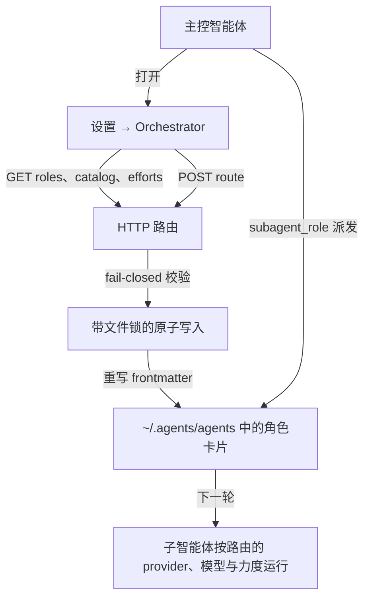

# dsh-orchestrator-kit

面向 AI 智能体团队的模型路由控制面板 — 在同一个设置页面中，为 20 角色 dev-flow 流水线中的每个角色分配 provider、模型与推理力度。

> **语言：** [English](README.md) · [Português (BR)](README.pt-BR.md) · 简体中文

[](https://www.npmjs.com/package/dsh-orchestrator-kit)
[](LICENSE)
[](#安装dsh)
[](https://github.com/klaus-2/dsh-orchestrator-kit/actions/workflows/ci.yml)
[](#安装dsh)


> 高清完整视频：[assets/demo.mp4](assets/demo.mp4) · Craft 工作流动态示意图：[docs/showcase.svg](docs/showcase.svg)

## 为什么使用

- **按角色路由** — Craft dev-flow 流水线（发现、规划、执行、验证）中的每个角色都可以使用自己的 provider、模型和推理力度。
- **成本与质量调优** — 只在真正划算的地方（架构、计划评审）投入深度推理能力，让检索类角色跑在更便宜的路由上。
- **fail-closed 校验的配置** — 保存时引用了未知角色、模型或力度会被以 409 拒绝；目录不可用返回 503。绝不写入死路由。
- **无 provider 锁定** — 面板本身不内置任何 provider；下拉列表由运行中的 harness 目录提供。

## 工作原理



设置页 **设置 → Orchestrator** 按三个 Craft 阶段分组展示 20 个流水线角色。每个角色卡片将所选路由写入其 frontmatter；下一次 `subagent_role` 派发（下一轮）即会生效。

## 安装（DSH）

要求：**Node.js >= 22**，以及启用 Agent Teams 的 **DSH 实例**。

1. 克隆或下载本仓库（已以 `dsh-orchestrator-kit` v0.1.0 发布到 npm — 无需全局安装）。
2. 在 DSH 中打开 **插件 → 添加插件**，指向下载的文件夹，**或**使用 `install_bundle` 安装。
3. Orchestrator 人设与 20 角色 dev-flow 流水线已随预设提供 — 无需额外配置。

### 更新

面板会让插件保持最新。每次启动约 15 秒后，它会检查 GitHub releases 是否有更新版本 — 只读检查，无需凭据 — 并在设置页面的更新行中显示结果。不会自动安装任何东西：只有当你按下更新行的更新按钮时，安装才会通过 harness 的插件管理器进行；需要重启 harness 才能完成时，更新行会给出提示。某个版本安装完成后，“新增内容”对话框会以面板语言显示该版本的发布说明，每个版本只显示一次。未通过 npm 安装的副本（重命名或链接的目录）只能手动更新：更新行会报告新版本，但更新需通过 设置 → 插件 进行。

## Craft 流水线捆绑包

`craft/` 以简单、可移植的文件形式提供流水线：

- `craft/agents/*` → 复制到 `~/.agents/agents/`（设置了 `$DSH_AGENTS_HOME` 时为 `$DSH_AGENTS_HOME/agents/`）— 20 张角色卡片。
- `craft/skills/dev-flow` → 复制到 `~/.agents/skills/dev-flow` — dev-flow 技能及其 playbook。

未配置的角色使用 `model: inherit` — 跟随会话的路由。只覆盖你真正想固定到某个模型的角色。

## 按角色配置

| 控件 | 行为 |
| --- | --- |
| **Disabled** | 取消该角色的路由覆盖。 |
| **Provider** | 从 harness 目录中选择。 |
| **Model** | 从 harness 目录中选择。 |
| **Reasoning effort** | 选项按 provider + 模型的组合懒加载。 |
| **Save** | 先做 fail-closed 校验，再原子写入。 |
| **重置 — 会话默认（继承）** | 将角色恢复为 `model: inherit`。 |

面板以响应式卡片网格布局角色。顶部分段过滤器可在 All roles、三个 Craft 阶段与 Other 之间切换（方向键在标签间移动），每个标签在其计数旁显示 已路由 / 继承 / 已禁用 分布。图例下方的一行视图控件添加了搜索框（匹配角色名称或描述）、状态过滤器（全部状态、已路由、继承对话、已禁用）、排序下拉框（按名称、已路由优先、继承优先 — 在每个分区内应用）和密度下拉框（卡片或紧凑单行列表）— 全部与阶段标签组合生效。可折叠图例说明每个控件的作用，每张卡片带状态徽标（Routed、Inherits chat 或 Disabled），页眉汇总已保存的计数。继承的角色在 harness 目录提供会话默认路由时会在卡片上显示该默认路由，标准模式的卡片预留布局空间（`content-visibility`）让滚动保持流畅。

面板默认跟随 harness 语言：English、Português (BR) 与 简体中文 提供完整翻译，其他宿主语言的面板文本回退到英文。页眉中的下拉框可在自动（宿主语言）、English、Português (BR) 与 简体中文 之间切换面板语言 — 只改变面板，绝不改变 harness 语言。该选择通过尽力而为的 `localStorage` 在当前浏览器会话内记住；在桌面端，本地源端口可能在应用重启之间变化，因此覆盖选择可能无法在应用重启后保留。若存储不可用，面板会静默跟随宿主语言。标签选择、图例状态与密度通过同样的尽力而为 `localStorage` 在当前浏览器会话内记住；搜索与排序是临时的。

保存与卡片当前完全相同的设置是一次空操作：面板会提示 “Already up to date”，不会写入任何内容。frontmatter 无效的卡片会在警告横幅中列出，在 frontmatter 修复之前无法在此编辑。

每次编辑都有防丢失保护。修改一张卡片会将其标记为未保存 — 卡片获得琥珀色边框，角色名称获得 “（未保存）” 后缀 — 且在存在未保存修改时离开页面会触发浏览器的离开确认。Ctrl+S / Cmd+S 保存获得焦点的卡片（无焦点时空操作）。未保存的草稿在切换标签与重新打开设置分区后仍然保留：只要卡片在服务器上的状态仍与草稿所基于的状态一致就会保留，磁盘上的外部变更会丢弃过期的草稿。普通 Refresh 按钮会重置草稿；下方的冲突操作才是保留草稿的路径。每次保存都提供撤销：每张卡片一个层级，仅限当前浏览器会话，绝不持久化 — 它恢复该次保存之前的设置。当保存或撤销因卡片在底层被更改而以 `409` 失败时，消息会提供 “重新加载已保存状态，保留修改”，它会重新读取已保存状态并重新应用草稿，绝不重新发送过期的 `mtimeMs`；设置了推理力度的保存出现 `409` 时还会指向推理力度下拉框。一个 aria-live polite 实时区域会播报最近一次保存或撤销的结果，已保存的卡片保持绿色边框直到下一次更改。

面板使用七条路由：`GET /api/dsh-orchestrator-kit.roles`、`GET /api/dsh-orchestrator-kit.catalog`、`GET /api/dsh-orchestrator-kit.efforts`、`GET /api/dsh-orchestrator-kit.events`、`GET /api/dsh-orchestrator-kit.diagnostics`、`GET /api/dsh-orchestrator-kit.update` 和 `POST /api/dsh-orchestrator-kit.route`。成功的响应在实际测量到耗时指标时才带有 `Server-Timing` 头（仅含耗时）——roles 读取、catalog 读取、路由校验与写入；未执行路由校验的无变更保存不带该头。图例显示最近一次加载的耗时。

每次保存都有端到端保护：

- **fail-closed 校验** — 未知的角色、模型或力度返回 `409`；目录不可用返回 `503`。绝不盲目写入。
- **原子写入** — 文件锁串行化写入者，TOCTOU 防护加写入后复检确认卡片，并核对预期的 `mtimeMs`，并发编辑器绝不会被静默覆盖。
- **唯一写入者** — 面板是这些路由唯一的写入者，保存的路由在下一轮生效。
- **严格的 frontmatter 写入门槛** — 拒绝锚点、别名与自定义 YAML 标签，frontmatter 上限 65536 字节并限制嵌套深度。带锚点、标签或嵌套过深的卡片仍会列出但只读（每次写入都返回 `400`），直到被清理；带别名或超出字节上限的卡片连宽松的列表解析都无法通过，只出现在无效卡片警告横幅中，不在网格里。
- **请求限制** — 路由保存请求体上限 65536 字节（超出返回 `413`，先于任何磁盘读取），且只接受已知字段（未知字段返回 `400`）。
- **锁占用的可操作提示** — 当其他写入者持有卡片锁时，保存返回 `503` 并给出锁名与重试指引；锁文件绝不会被自动删除。
- **密钥脱敏** — 错误响应体与日志中已知形式的密钥和用户主目录路径会被替换为 `[redacted]` 与 `[home]` 标记，错误码与上下文保持完整。
- **只读模式** — 设置 `DSH_ORCHESTRATOR_READONLY=1`（或 `true`）后，服务器会在读取请求体或触碰磁盘之前对每次保存返回 `403`；面板通过 roles 引导数据镜像该开关，禁用所有会修改数据的控件，并显示只读提示。导出保持可用 — 它只是读取。

## 批量应用、配置集、更改日志与诊断

- **按阶段批量应用** — 在某个阶段标签页（绝不会在 "All roles" 标签页）上，每个分区的标题都带有 **应用到阶段** 按钮。它把源卡片的草稿路由/力度（第一张带脏草稿的卡片）复制到该分区的所有其他卡片，逐卡发送保存请求，每张卡片携带自己的预期 `mtimeMs`。结果按卡片计：`409` 冲突会让循环继续并在该卡片上报告，非 409 的失败（例如 `503` 锁占用）会停止执行并报告已应用的部分，取消按钮会在当前卡片完成后停止。批量应用绝不是原子的 — 它是一系列普通的经过校验的保存。
- **路由配置集** — **导出配置集** 把所有角色的已保存路由写成一个带版本的 JSON（`version: 1`、`generator`、按角色 id 索引的 `roles`；任何位置都没有 `mtimeMs`）。**导入配置集** 先校验每一条目 — 不支持的版本、写了一半的路由或畸形 id 会拒绝整个文件且不写入任何内容；本机不存在的 id 会被跳过并计数。校验通过后，面板刷新卡片列表（新鲜的 mtime），再把每个条目当作普通保存应用；失败的条目会被报告，任何内容都不会被静默覆盖。
- **最近更改** — 每次成功保存都会向卡片旁的一个仅追加 JSONL 文件（`.orchestrator-audit.jsonl`）追加一条记录：时间、角色 id、前后的路由、来源。它不存储密钥，也不存储绝对路径，而且是尽力而为 — 审计写入失败绝不会让保存失败或被回滚。面板的 **最近更改** 分区（图例内）显示最近 50 条记录，按需获取，从不缓存。
- **已安装卡片诊断** — 一个只读分区（图例内）报告：相对 `craft/` 源在已安装集合中缺失的角色、frontmatter 无效的卡片、引用实时目录中不存在模型的路由，以及正文与 craft 源不一致的卡片（frontmatter 合理地允许分叉；比较的是正文）。按需计算，从不缓存；`craft/` 不存在时优雅降级。

## 使用脚本安装 Craft 捆绑包

无需手动复制 `craft/`：

```
node scripts/install-craft.js [--dry-run]
```

该脚本会把 20 张角色卡复制到代理根目录（设置了 `$DSH_AGENTS_HOME` 时为 `$DSH_AGENTS_HOME/agents/`，否则为 `~/.agents/agents/`），并将 dev-flow 技能树复制到 `<agents home>/skills/dev-flow/`。它 **总是跳过已存在的文件** — 没有覆盖模式，没有备份 — 因此用户编辑过的卡片绝不会被覆盖；想重新安装就删除该文件。持有中的写入锁会产生文档化的重试/操作指引，脚本以退出码 1 结束。`--dry-run` 报告将要复制的内容而不写入任何东西。

## 20 个角色

**Discovery & Advisory（发现与咨询）**

| 角色 | 职责 |
| --- | --- |
| `repo-scout` | 本地代码库检索：定位代码、模式与事实。 |
| `docs-scout` | 外部文档与开源示例调研。 |
| `media-analyst` | 阅读 PDF、图片与截图。 |
| `arch-advisor` | 架构决策与深度评审。 |

**Planning & Execution（规划与执行）**

| 角色 | 职责 |
| --- | --- |
| `scope-analyst` | 计划前的缺口与歧义分析。 |
| `planner` | 编写 `.devflow/plans/*.md` 计划。 |
| `plan-auditor` | 审计计划的清晰度与可验证性（`OKAY`/`REJECT` 关口）。 |
| `run-conductor` | 单跳计划编排与契约冻结。 |
| `implementer` | 有范围的代码与配置写入。 |
| `debugger` | 根因复现与外科手术式修复。 |

**Verification, QA & Docs（验证、QA 与文档）**

| 角色 | 职责 |
| --- | --- |
| `diff-reviewer` | 合并就绪的最终评审。 |
| `test-auditor` | 测试充分性与缺口评级。 |
| `test-writer` | 能复现失败的测试与防抖检查。 |
| `browser-qa` | 浏览器与 UI 的实时 QA。 |
| `error-auditor` | 静默失败与错误路径审计。 |
| `security-auditor` | 信任模型的安全评审。 |
| `perf-auditor` | 延迟、N+1 与内存/进程泄漏评审。 |
| `debt-auditor` | 可维护性与死路径审计。 |
| `docs-sync` | 文档的即时同步。 |
| `tech-writer` | 持久文档：README、架构与 API。 |

## 常见问题

**保存模型时为什么会收到 409？**
面板会用运行中 harness 的目录校验每次保存。409 表示所选的角色、模型或力度在其中不存在 — 请选择有效条目，而不是绕过校验。

**保存时为什么收到 503“busy”错误？**
另一个写入者正持有该卡片的锁。稍等片刻后重试。如果锁因其持有进程崩溃而成为孤儿锁，需要由操作员移除卡片旁的 `<card>.md.lock` 文件 — 插件绝不会自动删除锁。

**“Already up to date”是什么意思？**
这次保存是空操作：提交的设置与卡片完全一致，因此没有写入任何内容，也没有获取锁。校验仍会先执行 — 磁盘上已变更的卡片仍返回 `409`。只有当保存设置了显式路由时才会查询目录：设置相同路由的保存在目录不可用时仍返回 `503`，而仅重复当前 disabled 标记或推理力度的保存（以及重置为 inherit）不会查询目录。

**角色卡片存放在哪里？**
设置了 `$DSH_AGENTS_HOME` 时在 `$DSH_AGENTS_HOME/agents/`，否则在 `~/.agents/agents/`。面板是路由 frontmatter 的唯一写入者。

**如何重置角色？**
使用该角色的重置控件（“会话默认（继承）”）；它会设置 `model: inherit`，角色重新跟随会话路由。

**撤销是如何工作的？**
每次成功保存都会在该卡片上提供撤销按钮。撤销恢复该次保存之前的设置 — 每张卡片一个层级，仅限当前浏览器会话，绝不持久化，也不会链式撤销（撤销不会创建新快照，因此没有可重做的内容）。撤销请求携带保存前的设置与记录的保存后 `mtimeMs`，因此期间在磁盘上被更改的卡片会以 `409` 和冲突消息响应。

**标签旁边的数字是什么意思？**
每个标签显示其角色的 已路由 / 继承 / 已禁用 分布（按已保存状态计算），不受任何搜索或过滤器影响。这三个数字互斥且合计为该标签的角色数；页眉汇总将已路由和已禁用分别计数，因此这些数字可能重叠。

**没有 Agent Teams 能用吗？**
不能。路由在 DSH 通过 `subagent_role` 派发成员时生效，而这需要 Agent Teams。

**如何把路由应用到整个阶段？**
切换到该阶段的标签页，在源卡片上设置想要的路由/力度（它保持未保存状态），然后按下分区标题中的 **应用到阶段** 按钮。分区中的其他所有卡片都会以各自经过校验的保存收到该路由；汇总统计已应用、冲突与失败的角色数，取消按钮会在当前卡片完成后停止。

**如何把我的路由搬到另一台机器？**
使用 **导出配置集** 下载所有已保存路由的带版本 JSON，再到另一台机器上使用 **导入配置集**。导入会先校验整个文件再写入任何内容，跳过本机不存在的角色 id，并用重新读取的 `mtimeMs` 应用每个条目 — 绝不信任文件自带的 mtime（文件里没有）。

**更改日志存储在哪里？**
在角色卡片旁的一个仅追加 JSONL 文件中：设置了 `$DSH_AGENTS_HOME` 时为 `$DSH_AGENTS_HOME/agents/.orchestrator-audit.jsonl`，否则为 `~/.agents/agents/.orchestrator-audit.jsonl`。每次成功保存一行；面板的最近更改分区显示最近 50 条。该文件按设计增长 — 不想要历史记录时请手动裁剪。

**需要 provider 的 API 密钥吗？**
不需要。本套件不内置 provider — 下拉列表显示 harness 目录已有的内容，凭据由 harness 自身持有。

**面板支持哪些语言？**
English、Português (BR) 与 简体中文（en/pt-BR/zh）。面板默认跟随 harness 语言，页眉下拉框可手动切换面板语言，不影响 harness 语言。插件激活期间，Português (BR) 也会成为可选的 harness 语言（停用插件时移除），通用葡萄牙语（`pt`）解析到 pt-BR 词典。角色名称、卡片内容、provider/模型/力度名称与计数属于数据，保持原样。

**如何添加或修正翻译？**
编辑 `locale/<lang>.json` 中的 `panel` 对象，并将改动逐字镜像到 `client.js` 的 `PANEL_DICTS`。测试套件强制保持同步 — 三个 locale 文件的键集合必须一致，注册的词典必须与 JSON 的 `panel` 部分完全相同 — 任何漂移都会导致测试失败。

## 贡献

小 PR、Conventional Commits，并在推送前让 `node scripts/test.mjs` 连绿三次 — 见 [CONTRIBUTING.md](CONTRIBUTING.md)。

校验还包括原生覆盖率门槛（语句 70% / 函数 60%）与 `client.js` 的版本化字节预算；参考文档位于 `docs/`。命令与术语表见 [CONTRIBUTING.md](CONTRIBUTING.md)。

```bash
NODE_V8_COVERAGE=$(node -p "require('node:os').tmpdir()")/dsh-coverage node scripts/test.mjs
NODE_V8_COVERAGE=$(node -p "require('node:os').tmpdir()")/dsh-coverage-report node scripts/test.mjs --coverage-report --coverage-dir=$(node -p "require('node:os').tmpdir()")/dsh-coverage
```

两个覆盖率目录都必须位于仓库之外：卫生检查会扫描仓库树，V8 JSON 中嵌入的 npm 绝对路径会导致检查失败。重新测量前请清空数据目录：V8 会保留名称唯一的 JSON 文件，复用目录会把旧区间与本次运行混在一起。

## 安全

没有远程执行面：本套件提供本地 HTTP 路由、写入角色卡片 frontmatter，其唯一的对外流量是针对 GitHub 与 npm 的只读更新检查 — 无需凭据；安装通过 harness 的插件管理器进行。更改日志只记录角色 id 与路由值 — 绝不记录密钥、绝对路径或卡片内容 — 只读模式与安装脚本见 [SECURITY.md](SECURITY.md)。请按 [SECURITY.md](SECURITY.md) 私密上报。

## 许可证

[MIT](LICENSE)。变更记录见 [CHANGELOG.md](CHANGELOG.md)。
